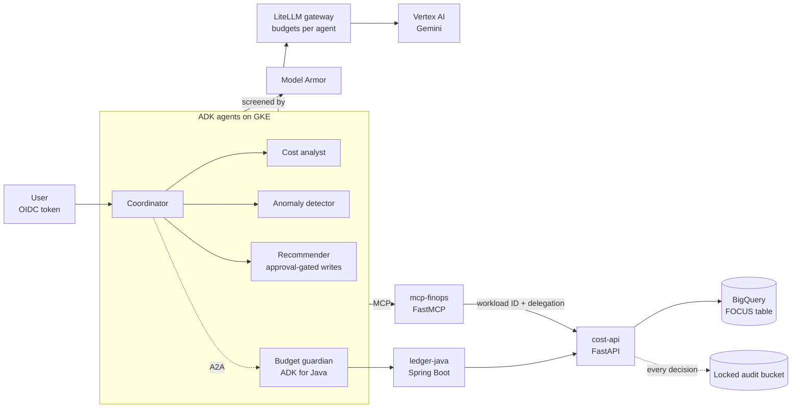

# Building Production AI Agent Platforms on Google Cloud

**From FinOps data to secure, governed multi-agent systems. A hands-on course in ten phases.**

[](https://github.com/faazeli/ai-agent-platforms-on-gcp/actions/workflows/course-ci.yml)
[](LICENSE)
[](LICENSE-docs)

You learn by building one realistic system end to end: **CostPilot**, a FinOps platform where AI agents answer "what did we spend, why, and what should we change?" over FOCUS-standard cost data in BigQuery. Each phase adds one layer, from typed APIs to multi-agent orchestration to Zero Trust security to GitOps delivery, and ends with something that runs, tests that prove it, and a decision record explaining it.

## Who this is for

Engineers moving into AI platform, agent infrastructure or FinOps tooling roles, typically with some Python and SQL and a little cloud experience. It covers the skills those roles ask for together and rarely teach together:

| Area | What you'll use |
| --- | --- |
| Agentic systems | Google ADK (Python and Java), LangGraph and LangChain, MCP with FastMCP, A2A, typed decisions with calibrated confidence (TypeSafe AI's Jev) |
| LLM architecture | Vertex AI, a LiteLLM gateway, prompt engineering as code, structured output parsing, evals, Model Armor guardrails, execution boundaries |
| APIs and integration | FastAPI, Pydantic, RFC 9457 Problem Details, Spring Boot 4 (Java) |
| Data | BigQuery, the FOCUS FinOps standard, partitioned and clustered OLAP design |
| Security and governance | OIDC, Workload Identity (KSA→GSA), RBAC at three layers, immutable audit logs |
| Infrastructure and delivery | Docker, OpenTofu, GKE Autopilot, GitHub Actions with WIF, Argo CD, Argo Rollouts, SLSA, Binary Authorization, OpenTelemetry, DORA; Harness as an alternative track (CI, eval-gated canaries, Continuous Verification, OPA policies) |
| Architecture judgement | GCP constraints, workload modelling, choosing and sizing resources |
| Leadership | ADRs, teaching, mentoring, code review, influence, golden paths, postmortems |

## What you'll build



## Course map

| Phase | Weeks | You learn | You produce | Cloud cost |
| --- | --- | --- | --- | --- |
| [1 · Typed APIs](phases/01-fastapi-pydantic-problem-details/) | 1–3 | Pydantic v2, FastAPI, RFC 9457 errors, testing | `cost-api` | $0 |
| [2 · FOCUS on BigQuery](phases/02-focus-on-bigquery/) | 4–6 | FOCUS, partitioning, clustering, MERGE, OLAP queries | A cost warehouse; BigQuery-backed API | ≈ $0 |
| [3 · MCP tools](phases/03-mcp-tools-with-fastmcp/) | 7–8 | MCP, FastMCP, tool design for models, structured output | `mcp-finops` | $0 |
| [4 · LLM gateway & Vertex AI](phases/04-llm-gateway-and-vertex-ai/) | 9–11 | Vertex AI, LiteLLM, prompts as code, evals, structured output repair, caching, RAG, batch | A gateway with budgets; an eval harness | ≈ $5–20 |
| [5 · Multi-agent systems](phases/05-multi-agent-adk-and-langgraph/) | 12–15 | ADK teams and Workflows, LangGraph, execution boundaries, injection testing, Agent Engine, typed decisions (optional) | An agent team, a LangGraph report, agent evals | ≈ $5–15 |
| [6 · Security & governance](phases/06-security-and-governance/) | 16–18 | Zero Trust, Workload Identity, delegation, RBAC, immutable audit, Model Armor | `costpilot-security`; secured services | ≈ $1–5 |
| [7 · Java integration](phases/07-java-integration/) | 19–20 | Spring Boot 4, contract tests, ProblemDetail, sealed types, ADK for Java, A2A | `ledger-java`, `budget-guardian` | ≈ $1 |
| [8 · GCP sizing](phases/08-gcp-sizing-and-constraints/) | 21–22 | GCP options and constraints, workload modelling, load testing | A sizing package and ADR | ≈ $5–20 |
| [9 · DevOps & delivery](phases/09-devops-and-delivery/) | 23–25 | Docker, OpenTofu, GKE, keyless CI/CD, eval gates, GitOps, canaries, supply chain, observability; the same pipeline in Harness (optional track) | The whole platform as code and pipelines | ≈ $3–6/day while running |
| [10 · Leadership](phases/10-leadership/) | all along; 26–27 | Writing, teaching, mentoring, reviewing, influencing, golden paths, postmortems | An evidence log | $0 |

About **27 weeks at 8–10 hours a week**. Phases build on each other, but every phase folder contains a working copy of what it needs, so you can start anywhere.

## How each phase works

```
phases/NN-name/
  README.md      why it matters, concepts, numbered labs, "done when", ADR prompt, teach-it prompt,
                 stretch goals, troubleshooting, teardown
  starter/       the code structure with the lab parts left as TODOs (work here)
  solution/      the reference implementation (peek only after trying)
  tests or the packages' own tests/   the same tests for both: your starter is done when they pass
```

Each lab ends with a **Check** you can run. Each phase ends with **Done when**, an **ADR** to write (template: [docs/adr-template.md](docs/adr-template.md)) and a five-minute **Teach it** exercise, which is where the leadership track gets practised continuously.

## Quick start

```bash
git clone https://github.com/faazeli/ai-agent-platforms-on-gcp.git && cd ai-agent-platforms-on-gcp
python data/generate_sample.py                 # the synthetic FOCUS dataset every phase uses
cd phases/01-fastapi-pydantic-problem-details/starter/cost-api
python -m venv .venv && source .venv/bin/activate
pip install -e ".[dev]"
pytest -q                                      # red: now open the Phase 1 README
```

Full environment setup (Python, Java, Docker, gcloud, a GCP project with a budget alert): [SETUP.md](SETUP.md). What each phase costs and how to keep it near zero: [COSTS.md](COSTS.md).

## Versions this course was built and tested with (October 2026)

| Component | Version | Notes |
| --- | --- | --- |
| Python | 3.11+ (tested on 3.13) | |
| FastAPI / Pydantic | 0.143 / 2.14 | |
| FastMCP | 3.4.8 | |
| google-adk (Python) | 2.12.0 | `Workflow` replaces the deprecated `SequentialAgent`/`ParallelAgent` |
| LangGraph / langchain-mcp-adapters | 1.2.15 / 0.3.2 | |
| LiteLLM | 1.x proxy | |
| Gemini on Vertex AI | `gemini-3.5-flash` (GA), `gemini-3.1-pro-preview` | behind the `fast` / `smart` aliases; check the model versions page |
| FOCUS | 1.4 (ratified 2026-06-04) | the course uses a stable core subset of columns |
| Spring Boot / Java | 4.1 / 21 | |
| ADK for Java | 1.7.1 | |
| OpenTofu / Google provider | 1.10 / 6.x–7.x | |
| Harness | pipeline schema v0 (harness-schema, `main`) | Phase 9 Track B; delegate with kustomize 5.7.1 |
| typesafe-sdk (TypeSafe AI, Jev) | 0.7.5 | Phase 5 Lab 5.9; *not* the `typesafe-ai` package |
| OPA | 1.4.2 | Harness policies |

### What was verified, and what wasn't

Every Python reference solution passes its test suite offline: models and agents run against scripted test doubles, cloud clients against fakes. The Java domain layer was compiled and exercised with JDK 21. Kubernetes manifests were rendered with kustomize and validated with kubeconform (including Argo CD and Argo Rollouts CRDs), Dockerfiles with hadolint, workflows with actionlint, and HCL with `tofu fmt`. The Harness pipeline and trigger validate against Harness's published JSON schema, its OPA policies pass `opa test`, and its scripts pass shellcheck. The Jev lab runs the real `typesafe-sdk` against a fake System One server.

Not executed when the course was built: the Spring Boot and ADK-for-Java Maven builds, Docker builds, `tofu plan/apply`, anything that calls a live GCP API, a live Harness account, or the live TypeSafe AI API. Those steps are written against current documentation, and their phase READMEs say so. If something in them breaks for you, please [open an issue](.github/ISSUE_TEMPLATE/broken-lab.md).

## Capstone

When you finish, you have a portfolio: ten phases of working code, fifteen or so ADRs, a sizing package, dashboards, and a leadership evidence log. Record a 10-minute demo that walks one question from the user through the coordinator, a specialist, an MCP tool, `cost-api` and BigQuery and back, then shows the audit trail and the trace for that same question, and ends with one decision you made and who else can now build on your work.

## Contributing

Corrections, clarifications and version bumps are welcome. See [CONTRIBUTING.md](CONTRIBUTING.md). The most valuable contribution is a report that a lab doesn't work as written, with the error you saw.

## License

Code is MIT ([LICENSE](LICENSE)). Course text is CC BY 4.0 ([LICENSE-docs](LICENSE-docs)). The sample data is synthetic.
