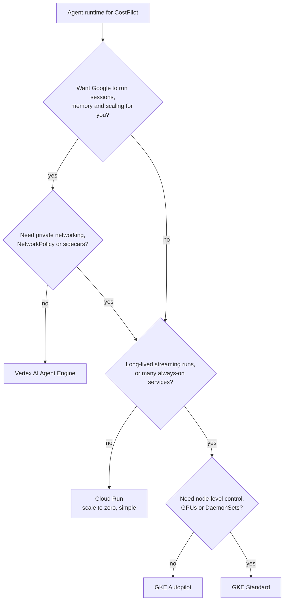

# Phase 8 — GCP constraints and choosing the right resources

| Time | Cloud cost | Builds on | You produce |
| --- | --- | --- | --- |
| Weeks 21–22 (≈ 18 h) | ≈ $5–20 for load tests (keep them short) | Phases 4, 5 (field notes, Agent Engine numbers) | A sizing package in `docs/sizing/`: options table, constraints register, workload model, load-test results, sizing ADR, cost estimate |

## Why this phase matters

Anyone can make an agent demo work. The senior skill is looking at an agentic design and saying what it will need, what will break first, and what it will cost, with numbers that survive a review. This phase sits between building (Phases 1–7) and automating (Phase 9) on purpose: decide what to run before you codify it in OpenTofu.

## You will learn

- The GCP options for each part of an agent platform, and the questions that decide between them
- The constraints that bite agentic systems: model quotas, regional availability, runtime limits, org policies, perimeters, residency
- Workload modelling: turning users and behaviour into peak requests and tokens per minute, monthly tokens and cost
- Load testing an agent runtime and reading the results
- Writing a sizing ADR that names the signal for revisiting it
- Making the platform report its own cost (labels → FOCUS → CostPilot)

## Before you start

1. Your Phase 4 field notes (quotas, latencies, caching and batch costs) and Phase 5's Agent Engine numbers.
2. Read (about 2 hours):
   - [Google Cloud Architecture Framework](https://cloud.google.com/architecture/framework): the cost optimization and reliability pillars
   - [Choose a compute option on Google Cloud](https://cloud.google.com/docs/choosing-a-compute-option) and [GKE Autopilot overview](https://cloud.google.com/kubernetes-engine/docs/concepts/autopilot-overview)
   - [Vertex AI Provisioned Throughput](https://cloud.google.com/vertex-ai/generative-ai/docs/provisioned-throughput) and [quotas](https://cloud.google.com/vertex-ai/generative-ai/docs/quotas)
   - [BigQuery pricing: on-demand vs editions](https://cloud.google.com/bigquery/pricing)

```bash
cd phases/08-gcp-sizing-and-constraints
pip install pyyaml pytest locust
pytest -q tests
```

## What's in this folder

```
templates/options-table.md          Lab 8.1
templates/constraints-register.md   Lab 8.2  (with lookup commands)
sizing/workload_model.py            Lab 8.3  workload → peak RPM/TPM, cost, quota headroom
sizing/assumptions.example.yaml     placeholder assumptions (replace prices and quotas!)
loadtest/locustfile.py              Lab 8.4  the same traffic against any runtime
templates/sizing-adr-template.md    Lab 8.4
sql/costpilot_self_cost.sql         Lab 8.5
```

Copy the templates into your own repo's `docs/sizing/` and fill them in there.

## Choosing an agent runtime, in one picture



The picture is a starting hypothesis, not an answer. Lab 8.4 replaces it with measurements.

## Labs

### Lab 8.1 — Map the options for each component

Fill in `templates/options-table.md` for CostPilot: agent runtime, model serving, gateway, tool services, analytics, state, async work, secrets, ingress. For each choice, the evidence column must point at a number or a constraint, not "best practice".

### Lab 8.2 — A constraints register

Fill in `templates/constraints-register.md` with *your* values (each row has the lookup command or page). Agentic systems hit these more than classic web apps do: model quotas are per region and per model, models retire on a schedule, and an agent run can last longer than some runtimes allow a request to.

Two to check carefully:

- **Model retirement.** Gemini model ids have retirement dates. With the Phase 4 gateway, switching is a one-line config change, but only if your evals (Phase 5) tell you the new model is safe. Put the dates in your calendar.
- **Org policies.** If `iam.disableServiceAccountKeyCreation` is enforced in your organization, anything that needs a key file will fail. That is good news: you built for Workload Identity in Phase 6.

### Lab 8.3 — Size from a workload model

Write the assumptions down, then compute. The worked example in `sizing/assumptions.example.yaml`:

- 200 users × 5 questions a day = **1,000 questions a day**
- 6 model calls per question (4 `fast` + 2 `smart`) = **6,000 calls a day**, at about 3,800 tokens each (3,000 in, 800 out) = **22.8M tokens a day**
- 30% of traffic in the busiest hour → 1,800 calls an hour = 30 calls a minute × 3,800 = **114,000 tokens a minute at peak**

```bash
python sizing/workload_model.py sizing/assumptions.example.yaml
python sizing/workload_model.py sizing/assumptions.example.yaml --scale users=5      # what breaks first?
```

Copy the YAML to your repo, **replace every placeholder price and quota** with current pricing and your own quotas, and replace guesses with measurements where you have them (count model calls per question in Phase 5's `adk web` traces). Then:

1. Find the first limit that breaks as users grow. The script exits with code 2 and lists quota warnings when peak use passes 80% of a quota.
2. Work out how much context caching (Phase 4) would save at this volume.
3. Work out at what volume Provisioned Throughput beats pay-as-you-go for `smart`.

### Lab 8.4 — Load test, then decide

Run the same traffic against at least two runtimes. The Phase 5 agents run under `adk api_server` locally, and the same container runs on Cloud Run or GKE once Phase 9 builds it. For Agent Engine, reuse Phase 5's `deploy.py ask` in a loop.

```bash
locust -f loadtest/locustfile.py --host http://localhost:8000 \
       --users 20 --spawn-rate 2 --run-time 10m --headless --csv results/local
```

Record p50 and p95 latency, the failure rate (including 429s and budget stops), and the gateway's spend during the run (`/key/info` for the eval key). Keep runs short: every simulated question costs real model calls.

Then write the sizing ADR from `templates/sizing-adr-template.md`: chosen resources, rejected options and why, and the **signal that would make you revisit** the decision.

### Lab 8.5 — Make the platform report on itself

1. Put `team=finops`, `service=<name>`, `env=<env>` labels on every CostPilot resource. Phase 9's OpenTofu applies them everywhere by default, and BigQuery jobs already carry `service:cost-api` (Phase 2).
2. Labels flow into the billing export, then into FOCUS `Tags` and `x_TeamId` (Phase 2's mapping). AI spend from the gateway arrives through `spend_to_focus.py` (Phase 4).
3. Run `sql/costpilot_self_cost.sql`, then ask CostPilot what CostPilot costs.
4. Set a budget with alerts per environment, and decide in your ADR whether committed use discounts make sense yet (hint: Phase 2's q05 shows what an under-used commitment looks like).

## Done when

- [ ] `docs/sizing/` holds the options table, the constraints register, your workload model YAML and its output, load-test results, and a sizing ADR
- [ ] Every price and quota in your workload model comes from a source you can name, with a date
- [ ] You know which limit breaks first as usage grows, and what you'd do about it
- [ ] After a week of running (Phase 9), your monthly cost estimate is within about 25% of actual spend, or you can explain the gap

## Write it down (ADR)

`0013-runtime-and-capacity.md`, from `templates/sizing-adr-template.md`.

## Teach it (5 minutes)

Present the workload model as one slide: assumptions on the left, peak TPM and monthly cost on the right. Ask the room which assumption they doubt most. Changing it live with `--scale` is the most persuasive minute of the talk.

## Stretch goals

- Extend the model with a second traffic class (scheduled monthly reports via batch) and compare its cost with live calls.
- Add regional failover to the options table: what would serving from two regions cost, and what would it buy?
- Model the BigQuery side too: bytes scanned per question × questions per month, against on-demand pricing versus a small editions reservation.
- If you did Lab 5.9: add anomaly triage as a traffic class (anomalies per day × one decision call each). Compare a decision API billed per call (check TypeSafe AI's current pricing) with the `fast` model's tokens per triage, and include the human-review minutes each decider's coverage implies. People are usually the largest line.

## Troubleshooting

| Symptom | Fix |
| --- | --- |
| Workload model says everything fits, but the load test throws 429s | Shared pay-as-you-go capacity can throttle below your quota. Check the gateway fallbacks, and consider Provisioned Throughput for steady traffic. |
| Load test latency is dominated by a few very slow runs | Look at p95 traces: usually a model retry, a long tool call, or a review loop. Cap them (Phase 5 budgets, Phase 3 timeouts). |
| Self-cost query returns nothing | Labels take a day to reach the billing export, and the export → FOCUS mapping must include them in `Tags`. |

## Teardown

Stop load-test targets you started only for this phase (Cloud Run services, Agent Engine deployments).
